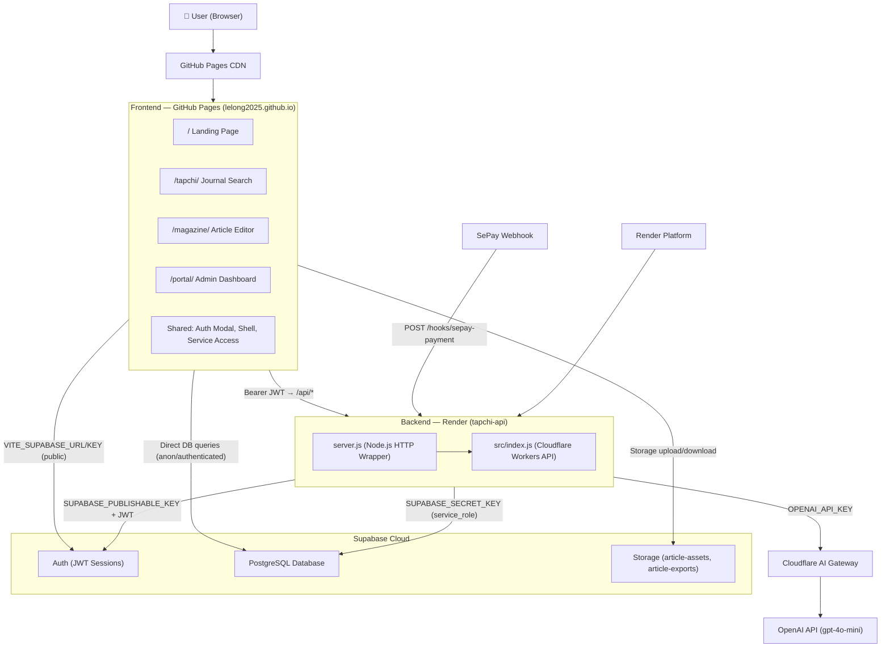
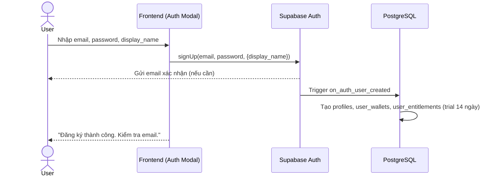
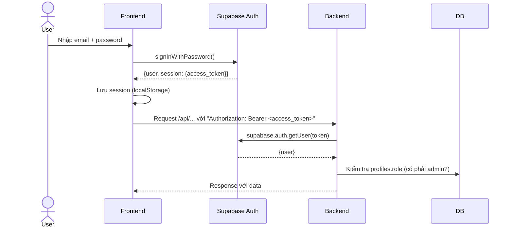
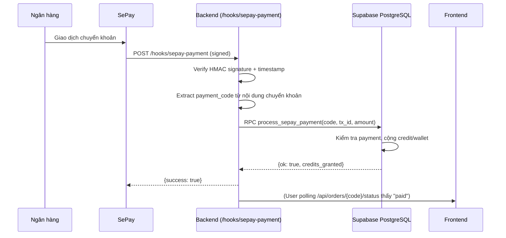
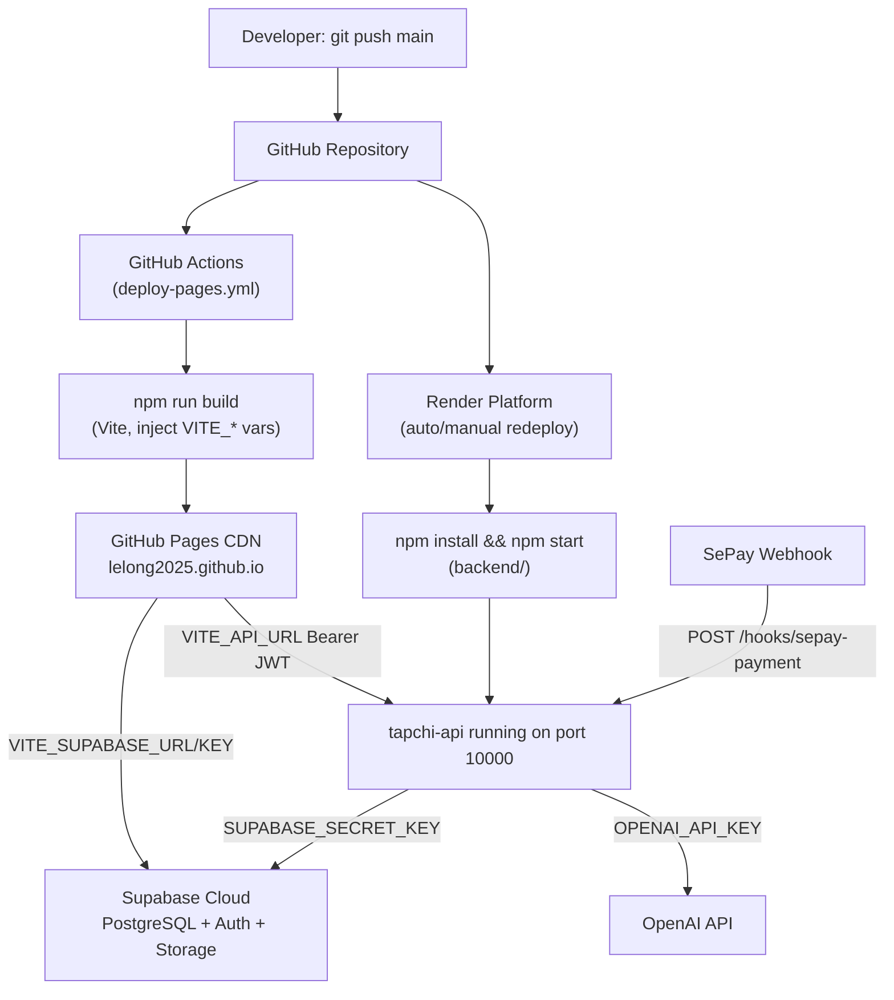
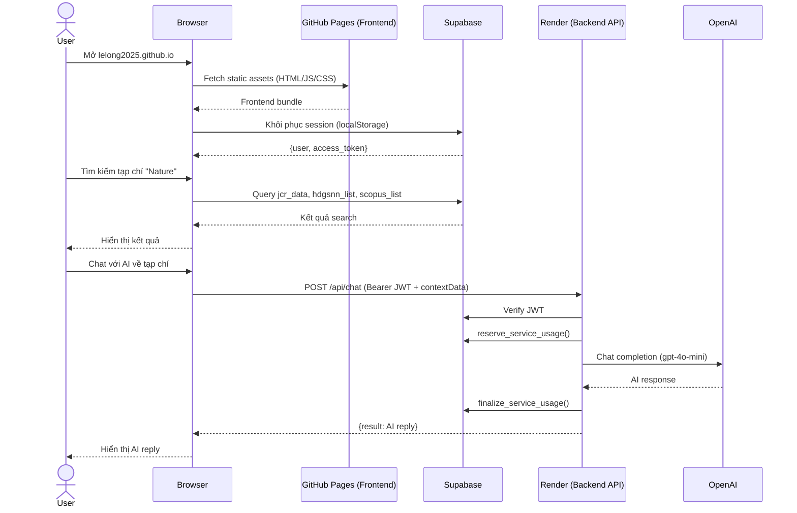

# LHU Journal Hub

**LHU Journal Hub** là nền tảng học thuật tích hợp dành cho Trường Đại học Lạc Hồng (LHU), bao gồm ba ứng dụng chính trong một monorepo:

1. **Tra cứu tạp chí** (`/tapchi/`) — Tra cứu điểm HĐGSNN 2025, JCR Impact Factor, Scopus, và các nguồn tra cứu ngoài theo tên tạp chí hoặc ISSN.
2. **LHU Journal** (`/magazine/`) — Soạn thảo bài báo khoa học, preview định dạng A4, AI Review, xuất Word/PDF, và quản lý số báo.
3. **Admin Portal** (`/portal/`) — Quản trị tài khoản, gói dịch vụ, lịch sử thanh toán, và cài đặt hệ thống.

Hệ thống bao gồm một **frontend Vite multi-page** được triển khai trên **GitHub Pages** và một **Node.js backend** được triển khai trên **Render**.

---

## Mục lục

- [Features](#features)
- [Tech Stack](#tech-stack)
- [Third-Party Services](#third-party-services)
- [Architecture](#architecture)
- [Project Structure](#project-structure)
- [Requirements](#requirements)
- [Getting Started](#getting-started)
- [Environment Variables](#environment-variables)
- [Database](#database)
- [Authentication](#authentication)
- [Feature Flows](#feature-flows)
- [API Overview](#api-overview)
- [Third-Party Service Setup](#third-party-service-setup)
- [Deployment](#deployment)
- [GitHub Setup](#github-setup)
- [Production Deployment Flow](#production-deployment-flow)
- [Updating the Application](#updating-the-application)
- [Testing](#testing)
- [Troubleshooting](#troubleshooting)
- [Security](#security)
- [End-to-End System Flow](#end-to-end-system-flow)

---

## Features

- **Tra cứu tạp chí khoa học** — Tìm kiếm theo ISSN hoặc tên tạp chí qua 3 nguồn cục bộ: HĐGSNN 2025, JCR (22.000+ tạp chí), Scopus (48.000+ tạp chí).
- **AI Chatbox** — Hỏi đáp với trợ lý AI chuyên về tạp chí khoa học, sử dụng GPT-4o-mini với dữ liệu cục bộ làm ngữ cảnh.
- **Nguồn tra cứu ngoài** — Tích hợp iframe và liên kết ngoài đến Non-APC, Resurchify, Web of Science, SCImago, Clarivate, v.v.
- **Soạn thảo bài báo** — Editor rich-text với preview A4, quản lý ảnh/bảng, phân số báo.
- **AI Review bài báo** — Gửi bài báo để AI đánh giá học thuật (GPT-4o-mini).
- **Xuất Word/PDF** — Xuất bài báo hoặc số báo đầy đủ sang định dạng Word hoặc PDF.
- **Hệ thống tài khoản** — Đăng ký, đăng nhập, dùng thử 14 ngày, mua gói dịch vụ theo credit hoặc monthly.
- **Thanh toán qua SePay** — Tích hợp thanh toán ngân hàng qua QR VietQR, webhook xác nhận tự động.
- **Admin Portal** — Quản lý người dùng, doanh thu, gói dịch vụ, nguồn tra cứu, cài đặt dùng thử.

---

## Tech Stack

### Frontend

| Technology | Version | Purpose |
|---|---|---|
| Vite | ^8.1.1 | Build tool, dev server, multi-page bundler |
| Vanilla JavaScript (ES Modules) | — | Frontend logic |
| Vanilla CSS | — | Styling (không dùng framework CSS) |
| Font Awesome | 6.5.0 (CDN) | Icon library |
| `@supabase/supabase-js` | ^2.109.0 | Supabase client (Auth + Database) |

> **Multi-page application**: Vite được cấu hình với nhiều entry points — `index.html`, `tapchi/index.html`, `magazine/index.html`, `magazine/editor.html`, `magazine/publishing.html`, `portal/index.html`.

### Backend

| Technology | Version | Purpose |
|---|---|---|
| Node.js | >=20 | Runtime |
| Vanilla Node.js HTTP (`node:http`) | — | HTTP server (không dùng framework) |
| `@supabase/supabase-js` | ^2.109.0 | Supabase Admin client |
| `dotenv` | ^17.4.2 | Environment variable loader |
| Cloudflare Workers-compatible API | — | Backend source (`src/index.js`) viết theo Workers API |

> **Lưu ý kiến trúc**: `backend/src/index.js` được viết theo cú pháp **Cloudflare Workers** (`export default { async fetch(...) }`) và có thể deploy trên cả Cloudflare Workers (qua `wrangler`) lẫn Node.js thông thường (qua `backend/server.js` wrapper). `backend/wrangler.toml` cho thấy dự án đã từng hoặc đang xem xét Cloudflare Workers, nhưng **cấu hình deploy production hiện tại là Render** (xem `render.yaml`).

### Database

| Technology | Purpose |
|---|---|
| Supabase (PostgreSQL) | Cơ sở dữ liệu chính, auth, storage |

### Authentication

- **Supabase Auth** — Email/password, session JWT, password reset qua email.
- **Admin role** — Xác định qua bảng `profiles.role = 'admin'` và hàm `is_magazine_admin()`.

### Storage

- **Supabase Storage** — Hai bucket: `article-assets` (ảnh bài báo, public) và `article-exports` (file xuất DOCX/PDF, private).

### AI

- **OpenAI API** (`gpt-4o-mini`) — Chatbox AI và AI Review bài báo.
- **Cloudflare AI Gateway** — Proxy trung gian cho OpenAI API (URL cố định trong source code: `gateway.ai.cloudflare.com`).

### Payment

- **SePay** — Cổng thanh toán ngân hàng Việt Nam, webhook xác nhận chuyển khoản qua HMAC hoặc API Key.

### Deployment

| Platform | Purpose |
|---|---|
| GitHub Pages | Hosting frontend static build |
| GitHub Actions | CI/CD: build và deploy frontend tự động khi push `main` |
| Render | Hosting backend Node.js API |

### Development / Tooling

| Tool | Version | Purpose |
|---|---|---|
| npm | — | Package manager |
| Git | — | Version control |
| Node.js built-in test runner | — | Unit tests backend |

---

## Third-Party Services

### 1. Supabase

**Supabase** là backend-as-a-service cung cấp PostgreSQL database, authentication, và file storage.

Project dùng Supabase cho:
- **PostgreSQL Database** — Lưu dữ liệu tạp chí (HĐGSNN, JCR, Scopus), tài khoản người dùng, lịch sử thanh toán, gói dịch vụ, workspace soạn thảo.
- **Authentication** — Email/password sign-up, sign-in, password reset, session JWT.
- **Storage** — Bucket `article-assets` và `article-exports`.

Kết nối qua:
- Frontend: `VITE_SUPABASE_URL` và `VITE_SUPABASE_PUBLISHABLE_KEY`
- Backend: `SUPABASE_URL`, `SUPABASE_PUBLISHABLE_KEY`, `SUPABASE_SECRET_KEY` (service role key cho admin operations)

### 2. OpenAI API

**OpenAI** cung cấp mô hình `gpt-4o-mini` cho:
- **Chatbox AI** (`/api/chat`) — Trả lời câu hỏi về tạp chí khoa học với ngữ cảnh từ dữ liệu cục bộ.
- **AI Review** (`/api/magazine/review`) — Đánh giá học thuật bài báo, trả về JSON.

Kết nối qua: `OPENAI_API_KEY`

Lưu ý: Backend gọi OpenAI **qua Cloudflare AI Gateway** với URL cố định: `https://gateway.ai.cloudflare.com/v1/0b2220df0295474315b4b6940a0785e8/tapchi-gateway/openai/chat/completions`. Nếu muốn bỏ qua Cloudflare Gateway, cần thay URL trong `backend/src/index.js`. Nếu dùng Cloudflare Gateway, cần thêm header `cf-aig-authorization: Bearer <CLOUDFLARE_API_TOKEN>` — biến `CLOUDFLARE_API_TOKEN` **không có trong `render.yaml`** nên có thể không được set trong production (kiểm tra lại).

### 3. SePay

**SePay** là dịch vụ webhook ngân hàng Việt Nam, tự động nhận thông báo khi khách hàng chuyển khoản.

Project dùng SePay để:
- Nhận webhook tại `/hooks/sepay-payment` khi có giao dịch chuyển khoản khớp với mã đơn.
- Xác minh webhook bằng HMAC SHA-256 hoặc API Key.
- Tự động kích hoạt gói dịch vụ sau khi thanh toán thành công.

Kết nối qua:
- `SEPAY_BANK` — Mã ngân hàng
- `SEPAY_ACCOUNT_NUMBER` — Số tài khoản nhận tiền
- `SEPAY_ACCOUNT_NAME` — Tên tài khoản (tùy chọn, hiển thị trên QR)
- `SEPAY_WEBHOOK_AUTH` — Phương thức xác thực webhook: `hmac` hoặc `api_key`
- `SEPAY_WEBHOOK_SECRET` — Secret HMAC (nếu dùng HMAC, tối thiểu 32 ký tự)
- `SEPAY_WEBHOOK_API_KEY` — API Key (nếu dùng api_key)

### 4. GitHub / GitHub Pages / GitHub Actions

- **GitHub** — Lưu trữ source code.
- **GitHub Pages** — Hosting frontend static build (domain `lelong2025.github.io`).
- **GitHub Actions** — Workflow `.github/workflows/deploy-pages.yml` tự động build và deploy frontend khi push lên nhánh `main`.

Workflow cần 3 **GitHub Repository Variables** (không phải secrets):
- `VITE_SUPABASE_URL`
- `VITE_SUPABASE_PUBLISHABLE_KEY`
- `VITE_API_URL`

### 5. Render

**Render** là nền tảng hosting backend Node.js API.

- Service name: `tapchi-api`
- Region: Singapore
- Root directory: `backend/`
- Build command: `npm install`
- Start command: `npm start`
- Port: `10000` (mặc định)

Cấu hình đầy đủ trong [`render.yaml`](render.yaml).

### 6. Cloudflare AI Gateway (Optional)

Backend gọi OpenAI qua Cloudflare AI Gateway để logging, caching, và rate limiting phía Cloudflare. Nếu `CLOUDFLARE_API_TOKEN` không được set, gateway vẫn có thể hoạt động tùy cấu hình Cloudflare.

---

## Architecture



### Mô tả các thành phần

| Thành phần | Vai trò |
|---|---|
| **Frontend (GitHub Pages)** | Static build gồm 5 HTML entry points, Vanilla JS, Vanilla CSS. Giao tiếp trực tiếp với Supabase (auth + DB) và gọi backend qua HTTP có JWT. |
| **Backend (Render/Node.js)** | Stateless HTTP server. Xử lý AI chat, AI review, thanh toán SePay, quản trị admin. Không expose trực tiếp DB ra ngoài — dùng Supabase service role key. |
| **Supabase Auth** | Quản lý session JWT. Frontend dùng `@supabase/supabase-js` để login/register/logout. Backend dùng admin client để xác minh JWT (`auth.admin.getUser`). |
| **Supabase PostgreSQL** | Lưu: dữ liệu tạp chí HĐGSNN/JCR/Scopus, `profiles`, `magazine_workspaces`, `article_submissions`, billing tables (`payments`, `service_usage`, `user_entitlements`, v.v.). |
| **Supabase Storage** | Lưu ảnh và file xuất bản của bài báo. |
| **OpenAI (qua Cloudflare AI Gateway)** | Model `gpt-4o-mini` cho cả chat và review. Backend inject dữ liệu tạp chí cục bộ vào system prompt. |
| **SePay** | Gửi webhook POST đến backend khi phát hiện giao dịch chuyển khoản. Backend xác minh HMAC, tra cứu mã đơn, kích hoạt gói dịch vụ qua Supabase RPC. |
| **GitHub Actions** | Build frontend (`npm run build`) với env vars từ GitHub Variables, upload artifact, deploy lên GitHub Pages. |

---

## Project Structure

```text
Lelong2025.github.io/
├── .github/
│   └── workflows/
│       └── deploy-pages.yml      # CI/CD: build & deploy frontend lên GitHub Pages
│
├── backend/                      # Node.js API server
│   ├── src/
│   │   └── index.js              # Toàn bộ API logic (Cloudflare Workers format, ~1700 dòng)
│   ├── test/
│   │   └── security.test.js      # Unit test xác minh SePay HMAC
│   ├── .env.example              # Template env vars cho backend
│   ├── package.json              # Dependencies: @supabase/supabase-js, dotenv
│   ├── server.js                 # Node.js HTTP wrapper chạy backend/src/index.js
│   └── wrangler.toml             # Cloudflare Workers config (nếu deploy lên Workers)
│
├── Database/                     # SQL migration scripts (chạy thủ công trên Supabase)
│   ├── migrate_multi_service_billing.sql   # Schema billing chính (chạy trước)
│   ├── migrate_lookup_sources.sql          # Bảng lookup_sources
│   ├── migrate_magazine_to_tapchi.sql      # Schema magazine (profiles, workspaces, submissions, storage)
│   ├── migrate_editorial_management.sql    # Cập nhật article_submissions
│   └── migrate_monthly_daily_limits.sql    # Cập nhật hệ thống daily limits
│
├── src/                          # Frontend source code
│   ├── shared/                   # Code dùng chung giữa các trang
│   │   ├── auth-modal.js         # Auth modal (login/register/reset password)
│   │   ├── auth-modal.css
│   │   ├── shell.js              # App shell: header, nav, AI chat panel
│   │   ├── shell.css
│   │   ├── service-access.js     # Kiểm tra quyền truy cập dịch vụ
│   │   ├── loader.js/css         # Loading overlay
│   │   └── utils/
│   │       ├── auth.js           # Wrapper Supabase Auth
│   │       ├── supabase.js       # Supabase client singleton
│   │       ├── api.js            # apiFetch() helper (tự thêm JWT header)
│   │       └── config.js         # appConfig, apiUrl() từ import.meta.env
│   │
│   ├── tapchi/                   # Trang tra cứu tạp chí
│   │   ├── search.js             # Logic tìm kiếm HĐGSNN/JCR/Scopus
│   │   ├── account.js            # Auth state, VIP check, public config
│   │   ├── chat.js               # AI Chatbox UI
│   │   ├── lookup-sources.js     # Nguồn tra cứu ngoài (iframe + link)
│   │   ├── main.js               # Entry point tapchi
│   │   └── tapchi.css
│   │
│   ├── magazine/                 # Trang soạn thảo bài báo
│   │   ├── magazine.js           # Login page logic
│   │   ├── modules/
│   │   │   ├── editor.js         # Rich-text editor core (~96KB)
│   │   │   ├── ui.js             # Editor UI (~65KB)
│   │   │   ├── ai.js             # AI Review integration
│   │   │   ├── export.js         # Word/PDF export (~68KB)
│   │   │   ├── cloud.js          # Supabase sync (workspace, submissions)
│   │   │   ├── state.js          # App state management
│   │   │   ├── utils.js          # Utility functions
│   │   │   └── supabase.js       # Supabase client for magazine
│   │   └── editor.css/publishing.css/login.css
│   │
│   ├── portal/
│   │   └── main.js               # Admin portal entry point
│   │
│   ├── main.js                   # Landing page entry point
│   └── landing.css               # Landing page styles
│
├── tapchi/
│   └── index.html                # Tra cứu tạp chí HTML entry (~45KB)
│
├── magazine/
│   ├── index.html                # Magazine login/redirect page
│   ├── editor.html               # Article editor HTML (~104KB, tự chứa)
│   └── publishing.html           # Publishing management HTML
│
├── portal/
│   └── (entry từ vite.config.js) # Admin portal HTML
│
├── public/                       # Static assets
│   ├── logo.png                  # Logo LHU
│   ├── lachong-auth-logo.png     # Logo cho auth modal
│   ├── robots.txt
│   └── sitemap.xml
│
├── supabase/
│   └── config.toml               # Supabase local dev config
│
├── index.html                    # Landing page
├── vite.config.js                # Vite multi-page config + proxy /api → localhost:10000
├── render.yaml                   # Render deployment config
├── package.json                  # Frontend dependencies
├── .env.example                  # Template env vars cho frontend
└── .gitignore
```

### Vai trò các thư mục quan trọng

| Thư mục/File | Mô tả |
|---|---|
| `backend/src/index.js` | **Toàn bộ backend API** trong 1 file. Không dùng Express — dùng Web API thuần. |
| `Database/` | **Migration scripts** — chạy thủ công qua Supabase SQL Editor. Không có auto-migration. |
| `src/shared/` | Code dùng chung: auth, shell UI, API helper. Import qua alias `@shared`. |
| `src/tapchi/` | Module tra cứu. Import qua alias `@tapchi`. |
| `src/magazine/` | Module soạn thảo. Import qua alias `@magazine`. |

---

## Requirements

- **Node.js** >= 20 (được xác định trong `backend/package.json`)
- **npm** (đi kèm Node.js)
- **Git**
- Tài khoản **Supabase** (project với PostgreSQL)
- Tài khoản **OpenAI** (API key)
- Tài khoản **SePay** (nếu dùng tính năng thanh toán)
- Tài khoản **GitHub** (để deploy lên GitHub Pages)
- Tài khoản **Render** (để deploy backend)

---

## Getting Started

### 1. Clone repository

```bash
git clone <repository-url>
cd Lelong2025.github.io
```

### 2. Cài đặt dependencies

#### Frontend

```bash
npm install
```

#### Backend

```bash
cd backend
npm install
cd ..
```

### 3. Cấu hình environment variables

#### Frontend (`.env` ở thư mục gốc)

```bash
cp .env.example .env
```

Chỉnh sửa `.env`:

```env
# Supabase public config (lấy từ Supabase Dashboard > Project Settings > API)
VITE_SUPABASE_URL=https://your-project.supabase.co
VITE_SUPABASE_PUBLISHABLE_KEY=your_anon_key_here

# API URL
# Local dev: để trống (Vite proxy sẽ forward /api/* đến localhost:10000)
# Production: đặt URL backend Render
VITE_API_URL=
```

#### Backend (`backend/.env`)

```bash
cp backend/.env.example backend/.env
```

Chỉnh sửa `backend/.env`:

```env
# Supabase
SUPABASE_URL=https://your-project.supabase.co
SUPABASE_PUBLISHABLE_KEY=your_anon_key_here
SUPABASE_SECRET_KEY=your_service_role_key_here

# OpenAI
OPENAI_API_KEY=your_openai_api_key_here

# SePay Webhook
SEPAY_WEBHOOK_AUTH=hmac
SEPAY_WEBHOOK_SECRET=your_random_secret_at_least_32_characters_here
SEPAY_BANK=your_bank_code
SEPAY_ACCOUNT_NUMBER=your_account_number
SEPAY_ACCOUNT_NAME=your_account_name

# CORS — danh sách origin được phép gọi API
ALLOWED_ORIGINS=http://localhost:5173,https://lelong2025.github.io

# Optional
PORT=10000
AI_RATE_LIMIT_MAX=30
AI_RATE_LIMIT_WINDOW_MS=60000
```

### 4. Database setup

> **QUAN TRỌNG**: Chạy các migration scripts theo đúng thứ tự sau trên **Supabase SQL Editor**.

#### Thứ tự chạy migration

```text
Bước 1: migrate_multi_service_billing.sql   ← Chạy trước tiên (billing schema chính)
Bước 2: migrate_magazine_to_tapchi.sql      ← Schema magazine, profiles, storage buckets
Bước 3: migrate_lookup_sources.sql          ← Bảng lookup_sources (nguồn tra cứu)
Bước 4: migrate_editorial_management.sql    ← Cập nhật article_submissions
Bước 5: migrate_monthly_daily_limits.sql    ← Cập nhật daily limits
```

#### Cách chạy

1. Vào **Supabase Dashboard** → **SQL Editor**
2. Dán nội dung từng file SQL vào editor
3. Click **Run** (từng file một, theo thứ tự)

#### Upload dữ liệu tạp chí

Bảng `jcr_data`, `hdgsnn_list`, `scopus_list` chứa dữ liệu tĩnh về các tạp chí. Các bảng này cần được import dữ liệu thực tế qua:
- **Supabase Dashboard → Table Editor → Import CSV**, hoặc
- **Supabase CLI** hoặc API

Cấu trúc các bảng này không có trong migration scripts trong repo — cần tạo thủ công hoặc có file import riêng không được commit vào repo.

### 5. Chạy local

#### Chạy backend trước

```bash
cd backend
npm start
# Server sẽ lắng nghe tại http://localhost:10000
```

#### Chạy frontend

Mở terminal mới ở thư mục gốc:

```bash
npm run dev
# Vite dev server tại http://localhost:5173
# Proxy /api/* → http://localhost:10000 (cấu hình trong vite.config.js)
```

Mở trình duyệt tại:
- **Landing**: `http://localhost:5173/`
- **Tra cứu tạp chí**: `http://localhost:5173/tapchi/`
- **LHU Journal Editor**: `http://localhost:5173/magazine/editor.html`
- **Admin Portal**: `http://localhost:5173/portal/`

---

## Environment Variables

### Frontend (root `.env`)

| Variable | Required | Purpose | Example |
|---|---|---|---|
| `VITE_SUPABASE_URL` | **Yes** | Supabase project URL | `https://abc.supabase.co` |
| `VITE_SUPABASE_PUBLISHABLE_KEY` | **Yes** | Supabase anon/public key | `eyJ...` |
| `VITE_API_URL` | No | Backend API base URL (để trống khi dev) | `https://tapchi-api.onrender.com` |

### Backend (`backend/.env`)

| Variable | Required | Purpose | Example |
|---|---|---|---|
| `SUPABASE_URL` | **Yes** | Supabase project URL | `https://abc.supabase.co` |
| `SUPABASE_PUBLISHABLE_KEY` | **Yes** | Supabase anon key (dùng để xác minh JWT user) | `eyJ...` |
| `SUPABASE_SECRET_KEY` | **Yes** | Supabase service role key (admin access) | `eyJ...` |
| `OPENAI_API_KEY` | **Yes** | OpenAI API key | `sk-...` |
| `ALLOWED_ORIGINS` | **Yes** | Comma-separated origins được phép CORS | `https://lelong2025.github.io` |
| `SEPAY_WEBHOOK_AUTH` | **Yes** | Phương thức xác thực SePay: `hmac` hoặc `api_key` | `hmac` |
| `SEPAY_WEBHOOK_SECRET` | Yes (nếu hmac) | HMAC secret, tối thiểu 32 ký tự | `your_secret_here...` |
| `SEPAY_WEBHOOK_API_KEY` | Yes (nếu api_key) | API key SePay | `your_api_key_here` |
| `SEPAY_BANK` | **Yes** | Mã ngân hàng SePay | `BIDV` |
| `SEPAY_ACCOUNT_NUMBER` | **Yes** | Số tài khoản nhận | `1234567890` |
| `SEPAY_ACCOUNT_NAME` | No | Tên tài khoản (hiển thị trên QR) | `NGUYEN VAN A` |
| `PORT` | No | Port server (mặc định: 10000) | `10000` |
| `AI_RATE_LIMIT_MAX` | No | Số request AI tối đa mỗi window (mặc định: 30) | `30` |
| `AI_RATE_LIMIT_WINDOW_MS` | No | Thời gian window rate limit ms (mặc định: 60000) | `60000` |

> **KHÔNG commit file `.env` vào Git**. File `.gitignore` đã loại trừ `.env` và `.env.*`.

---

## Database

### Database Provider

**Supabase PostgreSQL** — hosted trên Supabase Cloud.

### Schema Overview

#### Billing Tables (từ `migrate_multi_service_billing.sql`)

| Table | Mô tả |
|---|---|
| `service_products` | Danh sách sản phẩm dịch vụ: `chatbox_ai`, `magazine_export`, `magazine_ai_review`. Mỗi sản phẩm có `trial_days` và `trial_daily_limit`. |
| `service_plans` | Gói dịch vụ: `credit_pack` (gói credit) hoặc `monthly` (gói tháng). Gắn với từng `product_code`. |
| `user_wallets` | Ví điện tử của user (`balance_vnd`). Dùng cho wallet top-up và auto-renewal. |
| `user_entitlements` | Quyền truy cập dịch vụ của từng user: credit balance, monthly quota, trial dates. |
| `auto_renew_preferences` | Cài đặt tự động gia hạn khi hết credit, tự động trừ ví. |
| `service_daily_usage` | Số lần dùng dịch vụ theo ngày (reset hàng ngày). |
| `service_usage` | Log chi tiết từng lần dùng: `reserved` → `consumed` hoặc `refunded`. |
| `payments` | Đơn thanh toán: `pending` → `paid`, `expired`, `cancelled`. |
| `payment_events` | Log raw webhook SePay (deduplication). |

#### Magazine Tables (từ `migrate_magazine_to_tapchi.sql`)

| Table | Mô tả |
|---|---|
| `profiles` | Thông tin người dùng: `user_id`, `display_name`, `email`, `role` (`admin`/`client`). |
| `magazine_workspaces` | Trạng thái soạn thảo bài báo của user (`state` dạng JSONB). |
| `article_submissions` | Bài báo đã gửi lên: `article_snapshot` (JSONB), `status` (`submitted`/`imported`/`archived`). |

#### Lookup Sources Table (từ `migrate_lookup_sources.sql`)

| Table | Mô tả |
|---|---|
| `lookup_sources` | Nguồn tra cứu ngoài: URL template, tên, loại (`fixed`/`search`), display mode (`iframe`/`link`/`both`). |

#### Journal Data Tables (không có migration trong repo)

| Table | Mô tả |
|---|---|
| `jcr_data` | Dữ liệu JCR Impact Factor (~22k tạp chí). Fields: `journal_name`, `issn`, `eissn`, `category`, `jcr_2024`, `jcr_2025`, `jif_quartile`. |
| `hdgsnn_list` | Danh mục HĐGSNN 2025. Fields: `ten_tap_chi`, `issn`, `diem_hdgsnn`. |
| `scopus_list` | Danh mục Scopus. Fields: `source_title`, `issn`, `eissn`, `publisher`, `coverage`, `source_type`, `active_or_inactive`, `discontinued`. |

### Key Database Functions (PL/pgSQL)

| Function | Mô tả |
|---|---|
| `initialize_user_services(user_id)` | Tạo wallet + trial entitlements cho user mới. Được gọi bởi trigger `on_auth_user_created`. |
| `reserve_service_usage(...)` | Atomic: kiểm tra quyền và trừ credit/daily usage. Trả về `{allowed, reservation_id, source}`. |
| `finalize_service_usage(...)` | Xác nhận (`consumed`) hoặc hoàn lại (`refunded`) usage đã reserve. |
| `process_sepay_payment(...)` | Xử lý thanh toán: verify, update payment status, cộng credit/wallet. |
| `is_magazine_admin()` | Kiểm tra user hiện tại có role `admin` trong `profiles`. Dùng trong RLS policies. |
| `handle_new_user()` | Trigger function: tạo `profiles` và gọi `initialize_user_services` khi user mới đăng ký. |

### Row Level Security (RLS)

RLS được bật trên tất cả bảng billing và magazine. Các policy chính:

| Policy | Table | Rule |
|---|---|---|
| `public_read_active_service_products` | `service_products` | Ai cũng đọc được khi `active = true` |
| `public_read_active_service_plans` | `service_plans` | Ai cũng đọc được khi `active = true` |
| `users_read_own_wallet` | `user_wallets` | Chỉ đọc wallet của mình |
| `users_read_own_entitlements` | `user_entitlements` | Chỉ đọc entitlements của mình |
| `users_read_own_payments` | `payments` | Chỉ đọc payments của mình |
| `admin_read_all_payments` | `payments` | Admin đọc tất cả payments |
| `Users can read own magazine workspaces` | `magazine_workspaces` | Chỉ đọc workspace của mình |
| `Admins can read all submissions` | `article_submissions` | Admin đọc tất cả submissions |

> **Lưu ý**: Backend dùng `SUPABASE_SECRET_KEY` (service role) để bypass RLS trong các thao tác admin và payment processing.

### Storage Buckets

| Bucket | Access | Mô tả |
|---|---|---|
| `article-assets` | Public | Ảnh, tài nguyên nhúng trong bài báo |
| `article-exports` | Private | File xuất Word/PDF của user và admin |

---

## Authentication

### Flow Đăng ký (Sign Up)



### Flow Đăng nhập (Sign In)



### Session Management

- Session được quản lý bởi Supabase JS client, tự động refresh token.
- `src/shared/utils/auth.js` wrap `supabase.auth.*` thành helper methods.
- `src/shared/utils/api.js` (`apiFetch`) tự động đính kèm `Authorization: Bearer <access_token>` từ session hiện tại.

### Admin Role

Admin được xác định theo 2 cách:
1. `profiles.role = 'admin'` (kiểm tra qua RLS function `is_magazine_admin()`)
2. Backend kiểm tra lại `profiles` qua admin client khi xử lý request

### Password Reset

1. User nhập email → click "Quên mật khẩu?"
2. Frontend gọi `supabase.auth.resetPasswordForEmail(email, {redirectTo})`
3. Supabase gửi email với link reset (link chứa `?recovery=1` hoặc `?type=recovery`)
4. User click link → Frontend phát hiện URL recovery → mở form đặt lại mật khẩu
5. User nhập mật khẩu mới → `supabase.auth.updateUser({password})`

---

## Feature Flows

### 1. Tra cứu Tạp chí

#### User Flow

User vào `/tapchi/`, nhập ISSN hoặc tên tạp chí vào ô tìm kiếm, nhấn Enter hoặc click nút Tìm.

#### Frontend Flow

```text
tapchi/index.html
    → src/tapchi/main.js (entry)
    → initApp() [search.js]
        → initAuth() [account.js] — khôi phục session
        → loadPublicConfig() — lấy trial_days, price_vnd từ /api/public/config
        → loadLookupSources() — tải lookup_sources từ Supabase
        → Kiểm tra kết nối jcr_data, hdgsnn_list, scopus_list
        → Ẩn splash screen
    → search() [search.js]
        → publicDb.from('hdgsnn_list')...
        → publicDb.from('jcr_data')...
        → publicDb.from('scopus_list')...
        → Render kết quả HTML
        → updateLookupUrls(query) — cập nhật URL cho iframe/link sources
```

#### Database Flow

Frontend truy vấn trực tiếp Supabase với anon key:
- `jcr_data` — tìm theo `issn/eissn` hoặc `journal_norm ILIKE %query%`
- `hdgsnn_list` — tìm theo `issn` hoặc `ten_norm ILIKE %query%`
- `scopus_list` — tìm theo `issn/eissn` hoặc `source_title_norm ILIKE %query%`

#### External Sources

Sau khi search, cập nhật URL các iframe/link ngoài (Resurchify, Non-APC, Web of Science, v.v.) với keyword tương ứng.

---

### 2. AI Chatbox

#### User Flow

User đăng nhập, mở chat panel, đặt câu hỏi về tạp chí.

#### Frontend Flow

```text
Chat panel [src/tapchi/chat.js]
    → Kiểm tra VIP/trial access
    → Gọi /api/chat (POST) với messages + contextData (kết quả search hiện tại)
```

#### Backend Flow (POST /api/chat)

```text
withUserAuth() — xác minh JWT
    → handleChat()
        → Rate limiting (IP-based, in-memory)
        → reserve_service_usage() — kiểm tra và trừ quota
        → Xây dựng system prompt với contextData (HĐGSNN/JCR/Scopus matches)
        → Gọi OpenAI qua Cloudflare AI Gateway
        → finalize_service_usage() — xác nhận đã dùng
        → Trả về {result: <AI reply>, usage}
```

#### Usage Tracking

- Trial user: trừ `service_daily_usage` theo ngày.
- Credit pack user: trừ `user_entitlements.credit_balance`.
- Monthly user: trừ `service_daily_usage` theo ngày (giới hạn `monthly_balance`).
- Admin: không giới hạn.

---

### 3. AI Review Bài báo

#### User Flow

Trong editor bài báo, user click "AI Review" → hệ thống gửi nội dung bài → nhận đánh giá JSON.

#### Backend Flow (POST /api/magazine/review)

```text
withUserAuth()
    → handleMagazineReview()
        → Kiểm tra usage_reservation_id nếu có (pre-reserved)
        → Hoặc reserve_service_usage() mới
        → Gọi OpenAI với response_format: {type: "json_object"}
        → finalize_service_usage()
        → Trả về {content: <JSON string>}
```

---

### 4. Thanh toán & Kích hoạt Gói Dịch vụ

#### User Flow

User vào Portal → chọn gói → tạo đơn → quét QR → chuyển khoản ngân hàng.

#### Frontend Flow

```text
Portal [/portal/]
    → GET /api/services — tải thông tin tài khoản, gói dịch vụ
    → POST /api/orders — tạo đơn thanh toán
        → Backend trả về: payment_code, amount, qr_url (VietQR)
    → Frontend hiển thị QR code (từ vietqr.app)
    → Polling GET /api/orders/{code}/status — chờ webhook xác nhận
```

#### SePay Webhook Flow



---

### 5. Soạn thảo & Xuất bài báo

#### User Flow

User đăng nhập tại `/magazine/` → vào editor → soạn thảo bài báo → lưu lên cloud → xuất Word/PDF.

#### Frontend Modules

```text
magazine/editor.html
    → src/magazine/modules/editor.js   — Core rich-text editing
    → src/magazine/modules/ui.js       — UI components, panels
    → src/magazine/modules/state.js    — App state
    → src/magazine/modules/cloud.js    — Sync với Supabase (magazine_workspaces, article_submissions)
    → src/magazine/modules/export.js   — Xuất DOCX/PDF
    → src/magazine/modules/ai.js       — Gọi /api/magazine/review và /api/usage/reserve
```

#### Cloud Sync

- Workspace (bài báo đang soạn) được lưu vào `magazine_workspaces` (JSONB).
- Khi user submit, tạo record trong `article_submissions`.
- File xuất được upload lên Supabase Storage bucket `article-exports`.

---

## API Overview

Backend endpoint: được cấu hình qua `VITE_API_URL` (production) hoặc Vite proxy `/api` → `http://localhost:10000` (development).

| Method | Endpoint | Auth Required | Purpose |
|---|---|---|---|
| GET | `/` | No | Health check |
| GET | `/api/public/config` | No | Lấy trial_days và giá gói thấp nhất |
| POST | `/api/chat` | **Yes** | AI Chatbox (gpt-4o-mini) |
| POST | `/api/magazine/review` | **Yes** | AI Review bài báo (gpt-4o-mini) |
| GET | `/api/account` | **Yes** | Thông tin tài khoản, dịch vụ, lịch sử thanh toán |
| GET | `/api/services` | **Yes** | Thông tin chi tiết tài khoản dịch vụ |
| POST | `/api/usage/reserve` | **Yes** | Reserve usage slot trước khi dùng dịch vụ |
| POST | `/api/usage/finalize` | **Yes** | Xác nhận hoặc hoàn lại usage đã reserve |
| PATCH | `/api/renewals` | **Yes** | Cập nhật cài đặt tự động gia hạn |
| POST | `/api/orders` | **Yes** | Tạo đơn thanh toán |
| GET | `/api/orders/{code}/status` | **Yes** | Kiểm tra trạng thái đơn |
| DELETE | `/api/orders/{code}` | **Yes** | Hủy đơn pending |
| GET | `/api/admin/dashboard` | **Yes (Admin)** | Dữ liệu admin dashboard |
| PATCH | `/api/admin/settings` | **Yes (Admin)** | Cập nhật cài đặt trial |
| POST | `/api/admin/service-plans` | **Yes (Admin)** | Tạo gói dịch vụ |
| PATCH | `/api/admin/service-plans` | **Yes (Admin)** | Cập nhật gói dịch vụ |
| GET | `/api/admin/lookup-sources` | **Yes (Admin)** | Danh sách nguồn tra cứu |
| POST | `/api/admin/lookup-sources` | **Yes (Admin)** | Tạo nguồn tra cứu |
| PATCH | `/api/admin/lookup-sources` | **Yes (Admin)** | Cập nhật nguồn tra cứu |
| DELETE | `/api/admin/lookup-sources/{id}` | **Yes (Admin)** | Xóa nguồn tra cứu |
| POST | `/hooks/sepay-payment` | No (HMAC/API Key) | SePay payment webhook |

**Authentication**: Tất cả endpoint yêu cầu auth phải có header `Authorization: Bearer <supabase_access_token>`.

---

## Third-Party Service Setup

### Supabase Setup

1. Tạo tài khoản tại [supabase.com](https://supabase.com)
2. Tạo project mới (chọn region gần Việt Nam, ví dụ Singapore)
3. Vào **Settings → API** để lấy:
   - **Project URL** → `VITE_SUPABASE_URL` và `SUPABASE_URL`
   - **anon/public key** → `VITE_SUPABASE_PUBLISHABLE_KEY` và `SUPABASE_PUBLISHABLE_KEY`
   - **service_role key** → `SUPABASE_SECRET_KEY` (**giữ bí mật**)
4. Chạy migration scripts (theo thứ tự trong phần [Database Setup](#4-database-setup))
5. Vào **Authentication → Settings**:
   - Bật Email Auth
   - Cấu hình **Site URL** = `https://lelong2025.github.io` (production)
   - Thêm **Redirect URLs** nếu cần
6. Import dữ liệu tạp chí vào `jcr_data`, `hdgsnn_list`, `scopus_list`

### OpenAI Setup

1. Tạo tài khoản tại [platform.openai.com](https://platform.openai.com)
2. Vào **API Keys** → tạo key mới
3. Nạp credit vào account
4. Sao chép key vào `OPENAI_API_KEY`

> **Lưu ý về Cloudflare AI Gateway**: Backend hiện dùng URL cố định của Cloudflare AI Gateway. Nếu không có Cloudflare account, có thể đổi URL trong `backend/src/index.js` thành `https://api.openai.com/v1/chat/completions` và xóa header `cf-aig-authorization`.

### SePay Setup

1. Đăng ký tại [sepay.vn](https://sepay.vn)
2. Thêm tài khoản ngân hàng vào SePay
3. Tạo **Webhook**:
   - URL: `https://your-api.onrender.com/hooks/sepay-payment`
   - Authentication: HMAC (recommended) hoặc API Key
   - Nếu HMAC: copy secret key → `SEPAY_WEBHOOK_SECRET`
4. Lấy **mã ngân hàng** và **số tài khoản** → điền vào `SEPAY_BANK`, `SEPAY_ACCOUNT_NUMBER`
5. (Optional) Cấu hình prefix giao dịch trong SePay để hỗ trợ `extractSepayPaymentCode()`

### Render Setup (Backend)

1. Tạo tài khoản tại [render.com](https://render.com)
2. **New → Web Service**
3. Kết nối GitHub repository
4. Cấu hình:
   - **Root Directory**: `backend`
   - **Build Command**: `npm install`
   - **Start Command**: `npm start`
   - **Node Version**: 20
5. Thêm **Environment Variables** (từ danh sách backend env vars):
   - `SUPABASE_URL`, `SUPABASE_PUBLISHABLE_KEY`, `SUPABASE_SECRET_KEY`
   - `OPENAI_API_KEY`
   - `ALLOWED_ORIGINS` = `https://lelong2025.github.io`
   - `SEPAY_WEBHOOK_AUTH`, `SEPAY_WEBHOOK_SECRET`, `SEPAY_BANK`, `SEPAY_ACCOUNT_NUMBER`
6. Deploy và lấy URL của service (dạng `https://tapchi-api.onrender.com`)
7. Cập nhật `ALLOWED_ORIGINS` nếu cần

### GitHub Pages + Actions Setup

1. Tạo GitHub repository
2. Vào **Settings → Pages** → Source: **GitHub Actions**
3. Vào **Settings → Variables → Repository variables** (không phải secrets) → thêm:
   - `VITE_SUPABASE_URL`
   - `VITE_SUPABASE_PUBLISHABLE_KEY`
   - `VITE_API_URL` = URL backend Render (ví dụ: `https://tapchi-api.onrender.com`)
4. Push code lên nhánh `main` → GitHub Actions tự động build và deploy
5. URL GitHub Pages sẽ là `https://<username>.github.io/<repo-name>/` hoặc custom domain

---

## Deployment

### Frontend → GitHub Pages

Được tự động hóa qua GitHub Actions workflow [`.github/workflows/deploy-pages.yml`](.github/workflows/deploy-pages.yml).

**Trigger**: Push lên nhánh `main` hoặc `workflow_dispatch` (chạy thủ công)

**Steps**:
1. Checkout code
2. Setup Node.js 20
3. `npm ci` — cài dependencies
4. `npm run build` — Vite build, output vào `dist/`
5. Deploy `dist/` lên GitHub Pages

**Env vars khi build**: Lấy từ GitHub Repository Variables (`vars.VITE_*`).

### Backend → Render

**Trigger**: Render tự động redeploy khi phát hiện commit mới trên nhánh `main` (cần bật auto-deploy trong Render dashboard, hoặc deploy thủ công).

**Build**: `npm install` (trong thư mục `backend/`)

**Start**: `node server.js` (qua `npm start`)

**Health check**: `GET /` → trả về `"Journal VIP API is running"`

---

## GitHub Setup

### First-time setup

```bash
# Initialize local repository
git init
git add .
git commit -m "Initial commit"

# Kết nối với GitHub repository
git remote add origin https://github.com/<username>/<repo-name>.git
git branch -M main
git push -u origin main
```

### Normal workflow

```bash
# Lấy code mới nhất
git pull

# Chỉnh sửa code...

# Commit và push
git add .
git commit -m "feat: mô tả thay đổi"
git push
```

Push lên `main` → GitHub Actions tự động chạy → Frontend deploy lên GitHub Pages.

---

## Production Deployment Flow



---

## Updating the Application

### Sau khi thay đổi Frontend code

```bash
git add .
git commit -m "fix/feat: mô tả"
git push
# → GitHub Actions tự động build và deploy lên GitHub Pages (~1-2 phút)
```

### Sau khi thay đổi Backend code

```bash
git add .
git commit -m "fix/feat: mô tả"
git push
# → Render tự redeploy nếu auto-deploy được bật
# Hoặc vào Render Dashboard → Manual Deploy
```

### Sau khi thay đổi Database Schema

1. Viết migration SQL mới trong thư mục `Database/`
2. Chạy thủ công trên **Supabase SQL Editor**
3. Commit file SQL vào repo

---

## Testing

### Backend Unit Tests

```bash
cd backend
npm test
```

Test file hiện có: [`backend/test/security.test.js`](backend/test/security.test.js)

Test bao gồm:
- Xác minh HMAC signature SePay hợp lệ
- Reject payload bị sửa đổi
- Reject signature đã replay (timestamp > 300 giây)

Sử dụng **Node.js built-in test runner** (`node --test`), không cần install thêm framework.

---

## Troubleshooting

### Lỗi: Missing required environment variables

**Vấn đề**: Backend không start, báo thiếu env var.

**Nguyên nhân**: `backend/.env` thiếu một trong các biến bắt buộc.

**Giải pháp**: Kiểm tra `backend/server.js` function `validateEnvironment()` — các biến bắt buộc là: `SUPABASE_URL`, `SUPABASE_PUBLISHABLE_KEY`, `SUPABASE_SECRET_KEY`, `OPENAI_API_KEY`, `ALLOWED_ORIGINS`.

---

### Lỗi: "Database chưa cập nhật" (migration_required)

**Vấn đề**: Backend trả về lỗi `migration_required`.

**Nguyên nhân**: Supabase chưa được chạy migration scripts.

**Giải pháp**: Chạy các file SQL trong thư mục `Database/` theo đúng thứ tự trên Supabase SQL Editor.

---

### Lỗi: CORS — "Origin not allowed"

**Vấn đề**: Frontend gọi API bị block bởi CORS.

**Nguyên nhân**: Origin của frontend không có trong `ALLOWED_ORIGINS`.

**Giải pháp**: Thêm origin frontend (ví dụ: `https://lelong2025.github.io`) vào env var `ALLOWED_ORIGINS` của backend, cách nhau bằng dấu phẩy.

---

### Lỗi: "Invalid or expired session"

**Vấn đề**: API trả về 401.

**Nguyên nhân**: JWT token hết hạn hoặc không hợp lệ.

**Giải pháp**: Đăng xuất và đăng nhập lại. Supabase JS client sẽ tự refresh token nếu còn refresh token.

---

### Lỗi: AI chat trả về "AI service temporarily unavailable"

**Vấn đề**: Chatbox không hoạt động.

**Nguyên nhân có thể**:
1. `OPENAI_API_KEY` không hợp lệ hoặc hết quota.
2. Cloudflare AI Gateway bị lỗi hoặc `CLOUDFLARE_API_TOKEN` không được set.

**Giải pháp**: Kiểm tra OpenAI dashboard cho quota. Kiểm tra Render logs cho chi tiết lỗi.

---

### Lỗi: SePay webhook trả về 401

**Vấn đề**: Webhook bị reject.

**Nguyên nhân**: HMAC signature không khớp hoặc timestamp lệch > 5 phút.

**Giải pháp**: Đảm bảo `SEPAY_WEBHOOK_SECRET` khớp giữa SePay config và backend. Kiểm tra server time sync.

---

### Lỗi: GitHub Actions build thất bại

**Vấn đề**: Workflow fail ở bước "Build frontend".

**Nguyên nhân có thể**: Thiếu GitHub Repository Variables.

**Giải pháp**: Kiểm tra `Settings → Variables → Repository variables` có đủ `VITE_SUPABASE_URL`, `VITE_SUPABASE_PUBLISHABLE_KEY`, `VITE_API_URL` chưa.

---

## Security

### Nguyên tắc quan trọng

1. **Không commit `.env`** — File `.gitignore` đã exclude `.env` và `.env.*`. Luôn dùng `.env.example` làm template.

2. **Phân biệt Public vs Secret keys**:
   - `VITE_SUPABASE_PUBLISHABLE_KEY` = anon key → **an toàn** để expose trong frontend build.
   - `SUPABASE_SECRET_KEY` = service role key → **tuyệt đối bí mật**, chỉ dùng ở backend, có thể bypass RLS.

3. **Row Level Security (RLS)** — Được bật trên tất cả bảng. User chỉ đọc/ghi dữ liệu của mình. Admin có thêm policies.

4. **JWT Verification** — Backend xác minh mọi request qua Supabase Auth (`getUser(token)`) trước khi xử lý.

5. **CORS** — Backend chỉ cho phép origin trong `ALLOWED_ORIGINS`. Localhost được thêm tự động cho dev.

6. **Rate Limiting** — Backend có in-memory rate limiter cho AI endpoints (mặc định 30 request/phút/IP).

7. **Request Size Limit** — Backend giới hạn body request ở 64KB.

8. **SePay Webhook Security**:
   - HMAC SHA-256 signature verification với timestamp check (±5 phút)
   - Constant-time comparison để tránh timing attacks
   - Deduplication qua `payment_events` table

9. **Không tự tạo secret** — `SEPAY_WEBHOOK_SECRET` phải tối thiểu 32 ký tự. Backend validate khi khởi động.

10. **Server-side Payment Processing** — Toàn bộ logic xác nhận thanh toán và cộng credit thực hiện ở backend (PostgreSQL RPC `process_sepay_payment`), không phải frontend.

---

## End-to-End System Flow

### User Journey Flow



### Deployment Flow

```text
Developer
    ↓ git push origin main
GitHub Repository
    ↓ triggers
GitHub Actions (deploy-pages.yml)
    ↓ npm ci + npm run build (inject VITE_* vars from GitHub Variables)
dist/ artifacts
    ↓ deploy
GitHub Pages CDN
    ↓ serve
lelong2025.github.io (Frontend)

Developer
    ↓ git push origin main (backend/ changes)
Render Auto-Deploy (hoặc Manual Deploy)
    ↓ npm install (backend/)
    ↓ npm start (node server.js)
tapchi-api on Render
    ↓ listen :10000
Backend API (https://tapchi-api.onrender.com)

Frontend ←→ Backend ←→ Supabase PostgreSQL/Auth/Storage
Backend ←→ OpenAI API (qua Cloudflare AI Gateway)
SePay ←→ Backend (POST /hooks/sepay-payment)
```

---

## Contributing

1. Fork repository
2. Tạo branch: `git checkout -b feature/ten-tinh-nang`
3. Commit: `git commit -m "feat: mô tả"`
4. Push: `git push origin feature/ten-tinh-nang`
5. Tạo Pull Request về nhánh `main`

---

## License

Not verified from repository — không tìm thấy file LICENSE trong repository.
